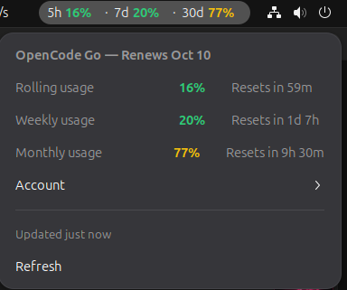
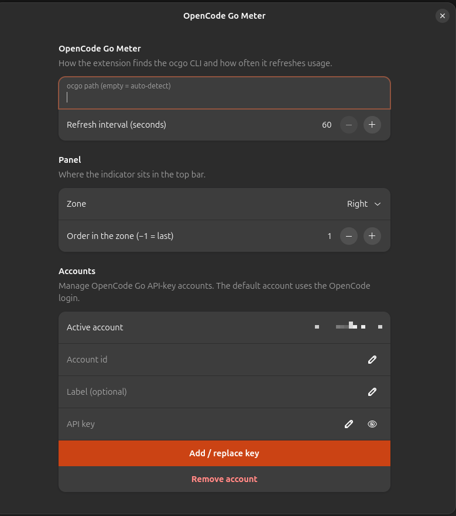

# opencode-go-meter

[](https://github.com/martinrdilo/opencode-go-meter/actions/workflows/test.yml)

OpenCode Go subscription usage in your panel — rolling 5-hour, weekly, and
monthly meters, always visible. A GNOME Shell extension and a Cinnamon applet,
backed by one portable Python core.



## Quick start

### GNOME Shell

```bash
git clone https://github.com/martinrdilo/opencode-go-meter
cd opencode-go-meter
make install
gnome-extensions enable opencode-go-meter@martinrdilo
```

The installer is safe to re-run and never copies files into system
directories. On Wayland, log out and back in if the indicator does not appear.

### Cinnamon

```bash
git clone https://github.com/martinrdilo/opencode-go-meter
cd opencode-go-meter
make install-cinnamon
```

Then right-click the panel → **Add applets to the panel** → **OpenCode Go
Meter**. The applet supports Cinnamon 5.4 and newer (Linux Mint 21 and up).

If the applet reports **OpenCode was not found** when you press *Log in with
OpenCode…*, the desktop session cannot see your OpenCode install. Install
OpenCode for that user, or run `opencode auth login` in a terminal where
`opencode` works, then press Refresh in the applet.

Uninstall with `make uninstall` / `make uninstall-cinnamon` — they remove only
links pointing into this repository.

### Dependencies

Both installers run a dependency check first:

- **python3 3.10+** — required.
- **libsecret-tools** — optional (the OS keyring). Without it the app stores
  API keys in a private local file that only your user can read. When it is
  missing, the check offers to install it with your consent; that is the only
  step that may ask for sudo.
- **OpenCode CLI** — optional; only the *Log in with OpenCode…* button needs
  it. Install from https://opencode.ai.
- **glib-compile-schemas** (`libglib2.0-bin` on Mint/Ubuntu) — needed by
  `make install` to compile the GNOME schema.

Run the check alone with `make deps`, or skip it with
`SKIP_DEPS=1 make install-cinnamon`.

## What you see

The panel shows all three windows as text: `5h 3% · 7d 64% · 30d 58%`.
Figures are consumed percentages, colored green below 50%, amber 50–84%, red
at 85% and above.

Click the indicator for the popup: each window with its reset countdown, the
subscription renewal date in the header, and a manual refresh with the time of
the last update. When the shown account is an OpenCode login, the popup can
also mirror the console's credits panel — the balance with its console state
(`Running low` under $5, `No credits left` at zero), the extra-usage switch,
and the auto-recharge state. Show or hide the section in the settings (GNOME:
Preferences → Popup → Show credits; Cinnamon: applet settings → Show credits).

In the terminal, `ocgo status` prints the same view and `ocgo refresh` updates
it now. When a refresh fails, the panel keeps the last good values and the
popup explains the error — nothing is invented.

## Accounts

A fresh install starts from what OpenCode already has: a stored login seeds the
`default` account and the meter works immediately. With API keys only, the app
starts with an explicit empty state and you add accounts from the settings or
the CLI. Accounts are OpenCode logins (`ocgo account discover` lists the stored
ones) or API keys from the OpenCode console (`oc_sk_…`). A login account is
**auto** — it follows the credential that `opencode auth switch` marks active —
or **pinned** to one stored login; every account shows its own meters and
credits.

```bash
ocgo account list                                  # accounts and the active one
ocgo account add personal --from-db                # register the auto login (only one auto login is allowed)
ocgo account add work --from-db --credential Work  # pin a stored login
ocgo account add temp --label "Temp"               # register an API key (prompted hidden)
ocgo account use work                              # switch the account shown by the app
ocgo account remove work                           # remove an account
```

- Replace or rotate a key — or convert a login into an API key — with
  `ocgo account set-key <id>`.
- Stored logins stay valid for about a month; one OpenCode has not used for
  that long shows as expired until it is used again — make it active
  (`ocgo account activate-in-opencode <id>`) and use OpenCode once.
- API-key accounts show the meters only: the console API rejects API keys for
  billing (HTTP 403). To see credits, keep an OpenCode login as the shown
  account.



## Security

- Credentials are handled only by `ocgo`: the OpenCode login is read from
  OpenCode's local stores in read-only mode; API keys live in the OS keyring
  (0600 file fallback) — never in logs, argv, or the usage cache.
- The GNOME and Cinnamon frontends never touch credentials: they read the usage
  cache and run the CLI.
- Requests go only to `opencode.ai`; the cache holds usage and credit numbers
  only.

## Development

```bash
make test            # Python unittest suite (core/tests)
make check-gnome     # GNOME extension static checks
make check-cinnamon  # Cinnamon applet static checks
make deps            # dependency check (also run by the installers)
```

See [AGENTS.md](AGENTS.md) for the agent-facing map and non-negotiables, and
[docs/01-architecture.md](docs/01-architecture.md) for the design.

## License

MIT — see [LICENSE](LICENSE).
