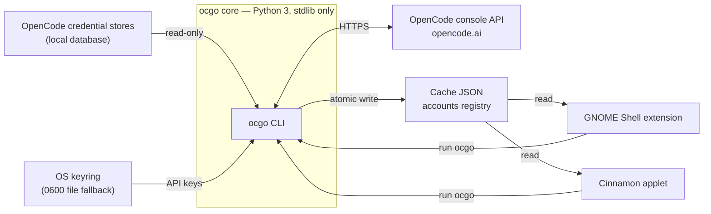

# Architecture

`opencode-go-meter` keeps OpenCode Go subscription usage (rolling 5-hour, weekly,
monthly) always visible on the Linux desktop. A GNOME Shell extension and a
Cinnamon applet render the same numbers the OpenCode Go console shows, and both
are powered by one portable core: the `ocgo` CLI. The core owns everything
sensitive and everything remote; the frontends only display what the core has
already fetched.

## The pieces

| Piece | Role |
|-------|------|
| Core CLI — `core/` | Python 3, standard library only. Resolves credentials, calls the console API, computes the percentages, writes the cache. Runs anywhere Python 3 runs. |
| GNOME frontend — `gnome/` | GNOME Shell 50 extension (ESM): top-bar indicator plus popup, GSettings preferences, timed and manual refresh. |
| Cinnamon frontend — `cinnamon/` | Cinnamon 5.4+ applet: the same indicators, popup, and settings surface. |
| Contracts | Cache JSON (schema v1), accounts registry (version 3), CLI interface. Versioned; every frontend depends on them and none may change them silently. |

## Data flow

Credential stores feed the core and nothing else. The frontends read the cache
for values and call the CLI for actions (refresh, account management); they
never see a token.

## Hard invariants

1. The core is Python 3 with the standard library only — no runtime
   dependencies, ever.
2. Credentials are handled only by the core. Secrets never reach logs, argv,
   the cache, or the frontends; API keys are entered over stdin.
3. Frontends stay thin: read the cache JSON, run `ocgo`, render the result.
   No credential access, no direct API calls.
4. The cache JSON and the accounts registry are versioned contracts. Changes
   are made by versioning the schema, never by silently breaking consumers.
5. Never invent values. With no accounts configured the UI shows an explicit
   empty state; a failed refresh keeps the last good values and records
   `last_error`.
6. All artifacts — code, docs, UI copy, commits — are written in English.

## Folder map

| Path | What it holds |
|------|----------------|
| `core/` | The portable `ocgo` package, its `bin/ocgo` launcher, and the tests under `core/tests/`. |
| `gnome/` | GNOME Shell 50 extension: `extension.js`, `prefs.js`, GSettings schema, and a static checker under `scripts/`. |
| `cinnamon/` | Cinnamon 5.4+ applet: `applet.js`, `settings-schema.json`, and a static checker under `scripts/`. |
| `docs/` | Public human docs, numbered by reading order; screenshots live in `docs/screenshots/`. |
| `odd/tasks/` | Internal feature tracking, one file per feature. |
| `skills/` | Agent convention skills, loaded on demand. |
| `Makefile` | Entry points for install, uninstall, and all checks. |
| `.github/` | CI workflow: tests and static checks on push and pull requests. |

## Where new things go

| Change | Where it goes |
|--------|----------------|
| New CLI command | `core/ocgo/cli.py`, with tests in `core/tests/` |
| New desktop frontend | A new top-level directory plus Makefile targets; the core must not change |
| New shared behavior | The core (`core/ocgo/`); frontends stay thin |
| New public doc | `docs/NN-name.md` with the next free number |
| New work item | `odd/tasks/<feature>.md`, on its own branch |

## Related

- [Technical decisions](05-technical-decisions.md) — why the system is shaped
  this way, as records.
- [AGENTS.md](../AGENTS.md) — the agent-facing map and non-negotiables.
- [project-conventions](../skills/project-conventions/SKILL.md) — operational
  rules for editing this repository.
