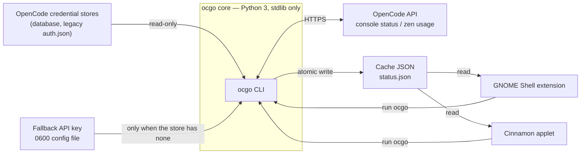

# Architecture

`opencode-go-meter` keeps OpenCode Go subscription usage (rolling 5-hour, weekly,
monthly) always visible on the Linux desktop. A GNOME Shell extension and a
Cinnamon applet render the same numbers the OpenCode Go console shows, and both
are powered by one portable core: the `ocgo` CLI. The core owns everything
sensitive and everything remote; the frontends only display what the core has
already fetched.

## The pieces

| Piece | Role |
|-------|------|
| Core CLI — `core/` | Python 3, standard library only. Resolves one credential (OpenCode store, then a fallback API key), calls the matching OpenCode endpoint, computes the percentages, writes the cache. Runs anywhere Python 3 runs. |
| GNOME frontend — `gnome/` | GNOME Shell 50 extension (ESM): top-bar indicator plus popup, GSettings preferences, timed and manual refresh. |
| Cinnamon frontend — `cinnamon/` | Cinnamon 5.4+ applet: the same indicators, popup, and settings surface. |
| Contracts | Cache JSON (schema v1) and the CLI interface. Versioned; every frontend depends on them and none may change them silently. |

## Data flow

The credential stores and the fallback key file feed the core and nothing
else. The frontends read the cache for values and call the CLI for actions
(refresh, credential settings); they never see a token.

A resolved credential carries a kind: `oauth` tokens (env token, store
`access`) go to the console status endpoint, `api` keys (an `opencode.db` /
`auth.json` `key`, or the fallback file) go to the zen usage endpoint.

## Hard invariants

1. The core is Python 3 with the standard library only — no runtime
   dependencies, ever.
2. Credentials are handled only by the core. Secrets never reach logs, argv,
   the cache, or the frontends; the fallback API key is entered over stdin and
   stored in a `0600` file only the core reads.
3. Frontends stay thin: read the cache JSON, run `ocgo`, render the result.
   No credential access, no direct API calls.
4. The cache JSON is a versioned contract and so is the CLI surface. Changes
   are made by versioning, never by silently breaking consumers.
5. Never invent values. With no resolvable credential the CLI reports the
   explicit no-credential error; a failed refresh keeps the last good values
   and records `last_error`.
6. All artifacts — code, docs, UI copy, commits — are written in English.

## Folder map

| Path | What it holds |
|------|----------------|
| `core/` | The portable `ocgo` package, its `bin/ocgo` launcher, and the tests under `core/tests/`. |
| `gnome/` | GNOME Shell 50 extension: `extension.js`, `prefs.js`, GSettings schema, and a static checker under `scripts/`. |
| `cinnamon/` | Cinnamon 5.4+ applet: `applet.js`, `settings-schema.json`, and a static checker under `scripts/`. |
| `docs/` | Public human docs, numbered by reading order; screenshots live in `docs/screenshots/`. |
| `odd/tasks/` | Internal feature tracking, one file per feature. |
| `skills/` | Agent convention skills, loaded on demand. |
| `Makefile` | Entry points for install, uninstall, and all checks. |
| `.github/` | CI workflow: tests and static checks on push and pull requests. |

## Where new things go

| Change | Where it goes |
|--------|----------------|
| New CLI command | `core/ocgo/cli.py`, with tests in `core/tests/` |
| New desktop frontend | A new top-level directory plus Makefile targets; the core must not change |
| New shared behavior | The core (`core/ocgo/`); frontends stay thin |
| New public doc | `docs/NN-name.md` with the next free number |
| New work item | `odd/tasks/<feature>.md`, on its own branch |

## Related

- [CLI reference](02-cli-reference.md) — every `ocgo` command, flag, and file.
- [Frontends](03-frontends.md) — GNOME vs Cinnamon behavior and settings.
- [Testing](04-testing.md) — checks, checkers, and CI.
- [Technical decisions](05-technical-decisions.md) — why the system is shaped
  this way, as records.
- [AGENTS.md](../AGENTS.md) — the agent-facing map and non-negotiables.
- [project-conventions](../skills/project-conventions/SKILL.md) — operational
  rules for editing this repository.
